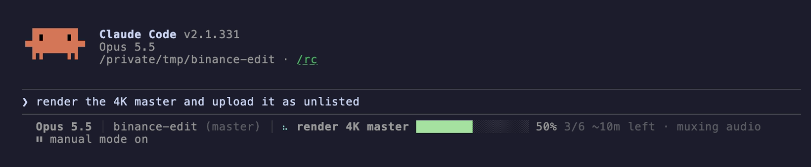

# claude-eta-statusline

A live ETA progress bar for long Claude Code tasks, in the status line.



Claude estimates how long a job will take, reports each finished step, and the status line draws a bar with the time left. It ticks every second, so it keeps moving during long silent commands like a 20-minute build.

## How it works

1. **Claude writes progress to a file.** A rule in `~/.claude/CLAUDE.md` tells Claude to call `claude-eta` around any task likely to run longer than about 3 minutes:
   ```bash
   claude-eta start "render edit" --eta 20m --total 6
   claude-eta step --note "muxing audio"
   claude-eta finish
   ```
   State goes to `~/.claude/eta/<session_id>.json`. Claude Code sets `CLAUDE_CODE_SESSION_ID` for every Bash command, so each session gets its own bar and parallel sessions don't collide.

2. **The status line reads it.** Claude Code pipes session JSON (including `session_id`) to `statusline.py`, which finds the matching file and renders the bar. `refreshInterval: 1` re-runs it every second.

3. **The ETA corrects itself.** At the start, the time left is Claude's guess. As steps finish, it blends toward the measured pace (elapsed ÷ steps done × steps left), weighted by how far along the task is. Inside a step, the bar creeps forward with time but never passes the next step boundary.

| State | Looks like |
|---|---|
| No task | `Opus 5.5 │ repo (branch)` |
| Steps + estimate | `⠹ build ██████░░░░ 40% 2/5 ~6m left` |
| Estimate only | `⠹ pip install ███████░░░ 70% ~1m left` |
| Over the estimate | bar turns yellow, then red: `+3m over` |
| No estimate | `⠹ scan logs 2m elapsed` |
| Finished | `✓ build done in 9m` (fades after 90 s) |

## Install

Requires Python 3 and a Claude Code version with `statusLine.refreshInterval`.

```bash
git clone https://github.com/jcpsimmons/claude-eta-statusline
cd claude-eta-statusline
./install.sh
```

The installer:
- copies the scripts to `~/.claude/eta-statusline/` and links `claude-eta` into `~/.local/bin`
- backs up `~/.claude/settings.json`, then sets:
  ```json
  "statusLine": {"type": "command", "command": "python3 ~/.claude/eta-statusline/statusline.py", "padding": 0, "refreshInterval": 1}
  ```
- appends the rule from [`CLAUDE-snippet.md`](CLAUDE-snippet.md) to `~/.claude/CLAUDE.md`

Options: `--no-claude-md` skips the CLAUDE.md rule (paste it into a project's CLAUDE.md instead), and `--force` replaces an existing status line.

Restart Claude Code, then give it something long. To see the bar right away, ask Claude to run `claude-eta start "demo" --eta 2m --total 4`.

## `claude-eta` reference

| Command | What it does |
|---|---|
| `start "<task>" [--eta 20m] [--total N] [--note ..]` | Begin a task. `--eta` is the total estimate. |
| `step [N] [--note ..]` | Mark N steps done (default 1). |
| `set [--eta 5m] [--done N] [--total N] [--task ..] [--note ..]` | Update fields. Here `--eta` means time **remaining from now**. |
| `finish` | Mark complete. |
| `status` / `clear` | Print or delete the state. |

Durations: `90s`, `15m`, `1h30m`, or a bare number of minutes.

## Config

Environment variables, read by both scripts:
- `CLAUDE_ETA_DIR`: state directory (default `~/.claude/eta`)
- `CLAUDE_ETA_BAR_WIDTH`: bar width in characters (default 16)

## License

MIT
